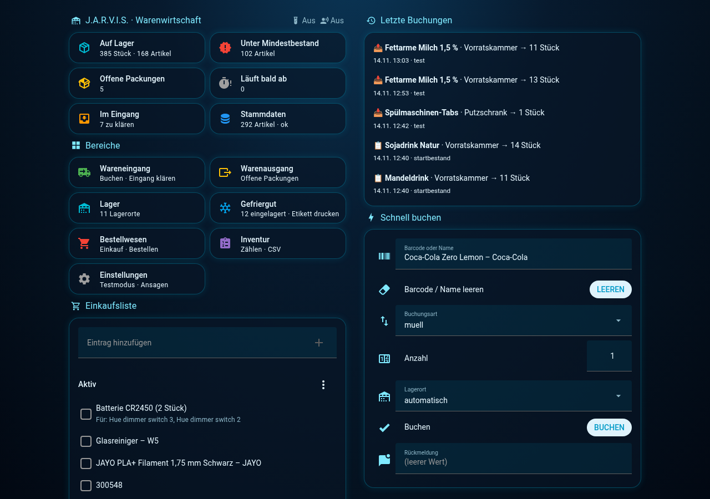
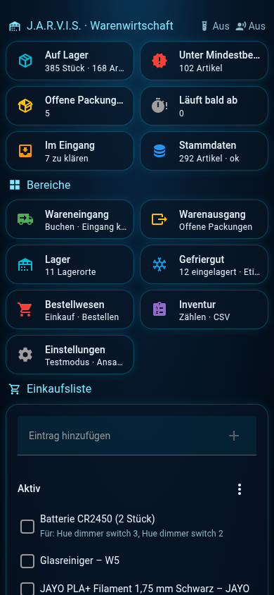
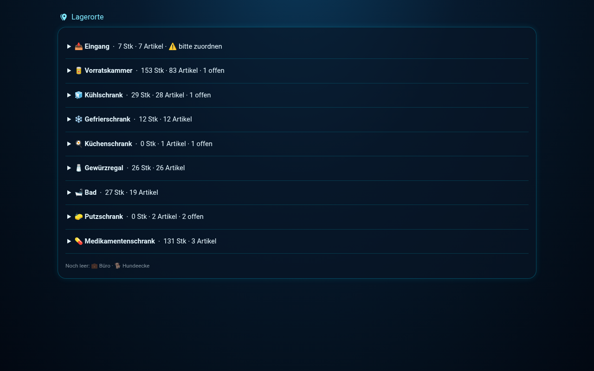
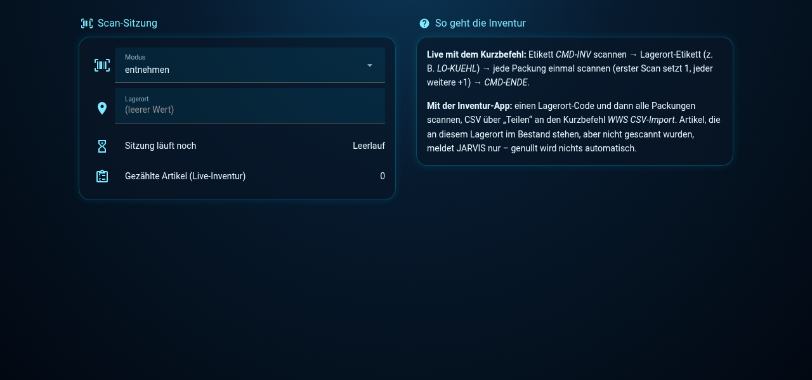

# 🏠 Warenwirtschaftssystem für Home Assistant

Ein komplettes Vorrats- und Lagersystem für den Haushalt – gebaut aus Home-Assistant-Bordmitteln, einer Google-Tabelle als Artikelstamm und einem Barcode-Scanner auf dem Handy.

- **Scannen statt tippen:** Etiketten für Befehle (`CMD-EIN`, `CMD-AUS`, `CMD-INV` …) und Lagerorte (`LO-KUEHL`, `LO-VORRAT` …), danach einfach die Produkte scannen.
- **Mehrere Lagerorte**, offene Packungen mit Haltbarkeit nach dem Öffnen, MHD-Überwachung mit Telegram-Bestätigung.
- **Mindestbestand → Einkaufsliste** automatisch, auch für Sammelartikel (z. B. „Milch“ über alle Marken).
- **Unbekannte Barcodes** werden bei OpenFoodFacts nachgeschlagen und automatisch angelegt.
- **Inventur** live per Scan oder als CSV aus einer Inventur-App.
- **Telegram:** `/wo senf` sagt, wo etwas liegt; `/artikel <EAN> Name – Marke` legt Unbekanntes an.
- **Meldungen im JARVIS-Stil** – als Sprachausgabe zu Hause, sonst per Telegram. Testmodus inklusive.
- **Google-Tabelle** als Artikelstamm (bequem am PC pflegen) plus Protokoll aller Buchungen.

## Bilder

| Lagezentrale | Handy |
|---|---|
|  |  |

| Lager je Lagerort | Inventur |
|---|---|
|  |  |

## So funktioniert es

```
Scan (Kurzbefehl / NFC / CSV / Dashboard / Kassenzettel)
        │
        ▼
 script.wws_scan ──► script.wws_buchen ──► script.wws_bestand_setzen ──► todo.warenwirtschaft_bestand
                           │                                                 (eine Zeile je Artikel + Lagerort)
                           ├──► Ereignis vorrat_gebucht ──► Meldungen · Einkaufsliste · Übersicht
                           └──► Google-Tabelle (Bestand + Buchungen)

Google-Tabelle (Artikelstamm) ──► sensor.wws_stammdaten (lokale Kopie, nachts + bei Bedarf)
```

Der Bestand liegt lokal in einer Todo-Liste (je Zeile ein JSON mit `code`, `ort`, `stk`, `offen`, `offen_seit`, `mhd`). Home Assistant funktioniert also auch, wenn Google kurz nicht erreichbar ist.

**Buchungsarten:** `einbuchen` · `entnehmen` (bei „wird angebrochen“ = Packungswechsel: alte offene Packung zu, neue auf) · `leer` · `muell` · `umbuchen` · `inventur` (Bestand fest setzen).

## Voraussetzungen

- Home Assistant 2025.x oder neuer mit **Packages** (`homeassistant: packages: !include_dir_named packages`)
- **Telegram bot**-Integration (für Rückmeldungen, `/wo`, `/artikel`, MHD-Buttons)
- **Local To-do** (für die Bestandsliste und Einkaufslisten)
- Ein Google-Konto für die Tabelle + Apps Script
- Optional: HACS-Karte **Mushroom** fürs Dashboard, iOS-Kurzbefehle, NFC-Tags, eine Barcode-App mit CSV-Export (z. B. „Barcode Scanner: Inventur CSV“)

## Einrichtung

1. **Google-Tabelle anlegen** – Blätter und Spalten siehe [docs/tabelle.md](docs/tabelle.md).
2. **Apps Script** – [google-apps-script/Code.gs](google-apps-script/Code.gs) in der Tabelle unter *Erweiterungen → Apps Script* einfügen, `TOKEN` setzen, als Web-App bereitstellen (*Ausführen als: Ich · Zugriff: Jeder*).
3. **Paket kopieren** – den Ordner `packages/warenwirtschaft/` nach `/config/packages/` kopieren.
4. **Platzhalter ersetzen:**

   | Platzhalter | Datei | Ersetzen durch |
   |---|---|---|
   | `DEINE_WEBAPP_URL`, `DEIN_TOKEN` | `schnittstelle.yaml` | Web-App-URL und Geheimwort aus Schritt 2 |
   | `!secret wws_telegram_chat_id` / `…config_entry_id` | mehrere | Einträge aus [secrets.example.yaml](secrets.example.yaml) in deine `secrets.yaml` |
   | `notify.mobile_app_DEIN_HANDY` | `automationen.yaml` | dein Mobile-App-Notify-Dienst |
   | `input_boolean.jemand_zuhause` | `skripte.yaml`, `automationen.yaml` | deine Anwesenheit (oder Helfer anlegen) |
   | `tts.DEIN_TTS`, `media_player.DEIN_LAUTSPRECHER` | `skripte.yaml` (`wws_ansage`) | deine Sprachausgabe |
   | `todo.einkaufsliste`, `todo.bestellen` | `automationen.yaml`, Dashboard | deine Einkaufslisten |

5. **Todo-Listen anlegen** (*Einstellungen → Geräte & Dienste → Integration hinzufügen → Local To-do*):
   - **Warenwirtschaft Bestand** → muss `todo.warenwirtschaft_bestand` heißen
   - **WWS Einkaufsliste Test** → `todo.wws_einkaufsliste_test` (für den Testmodus)
   - sowie deine Einkaufslisten, falls noch nicht vorhanden
6. **Neu starten**, dann unter *Entwicklerwerkzeuge → Zustände* prüfen: `sensor.wws_stammdaten` zeigt die Anzahl Artikel, Attribut `letzter_abruf_ok: true`.
7. **Dashboard** – Inhalt von [dashboard/warenwirtschaft.yaml](dashboard/warenwirtschaft.yaml) im Raw-Editor eines neuen Dashboards einfügen.
8. **Testen** – `input_boolean.wws_testmodus` einschalten (nichts wird in die Tabelle geschrieben), im Dashboard etwas einbuchen, dann Testmodus wieder aus.

## Scannen

**Webhook für Kurzbefehle / Scanner** (nur im Heimnetz):

```http
POST http://homeassistant.local:8123/api/webhook/vorrat_scan
{"code": "4012345678901"}                       # ohne Sitzung = 1 Stück entnommen
{"code": "CMD-EIN"} · {"code": "LO-VORRAT"} · {"code": "<EAN>"}   # Sitzung: 10 Minuten
{"code": "<EAN>", "art": "einbuchen", "lagerort": "Kühlschrank", "anzahl": 2}
```

**CSV-Import:** `POST /api/webhook/vorrat_csv` mit `{"csv": "<Inhalt>", "art": "inventur"}`. Eine `LO-…`-Zeile setzt den Lagerort für die folgenden Zeilen, `CMD-INV`/`CMD-EIN` in der CSV bestimmen die Buchungsart.

**NFC:** Tags mit der ID `wws-lo-kuehl`, `wws-cmd-ein` usw. setzen Lagerort bzw. Modus.

## Spezialvorräte

Vorräte mit eigener Zähllogik (Milch in ml, Kaffee in Gramm, Spülmaschinen-Tabs …) melden nur ihren Packungswechsel an `script.wws_packungswechsel` – mit optionalem `ort_offen`, damit die angebrochene Packung z. B. im Kühlschrank landet:

```yaml
- action: script.wws_packungswechsel
  data:
    code: "{{ states('input_text.milch_ean') }}"
    suche: milch
    ort_offen: Kühlschrank
    quelle: milch-packungswechsel
```

## Hinweise

- **Testmodus:** schreibt nicht in die Tabelle, legt keine Artikel an, Einkäufe nur auf die Test-Liste, Meldungen per Telegram mit 🧪.
- **Sammelartikel:** gleicher Eintrag in der Spalte *Sammelartikel* → Mindestbestand gilt für die Summe.
- **Gefriergut** (Codes `GG-…`) hat nie einen Mindestbestand.
- **Getränke** mit Standard-Lagerort Kühlschrank landen beim Einbuchen ab 6 Stück (Kiste) in der Vorratskammer.
- Die Texte sind im JARVIS-Stil („Master“) gehalten – einfach in `automationen.yaml`/`skripte.yaml` anpassen.

## Lizenz

MIT – siehe [LICENSE](LICENSE).
